## 👋 About me
 
- 💼 Freelance full-stack & mobile developer at **[Attic Group](https://attic-group.fr)**
- 🎓 Computer Science Bachelor's student at **Toulouse Ynov Campus**.
- 🚆 2.5 years as a work-study developer at **Fortil** (AI for railway document search)
- 🎨 Creative projects with **Axion Studio**

## 🛠️ Tech stack
 

 
## 📫 Contact
 

 
---
 

  

